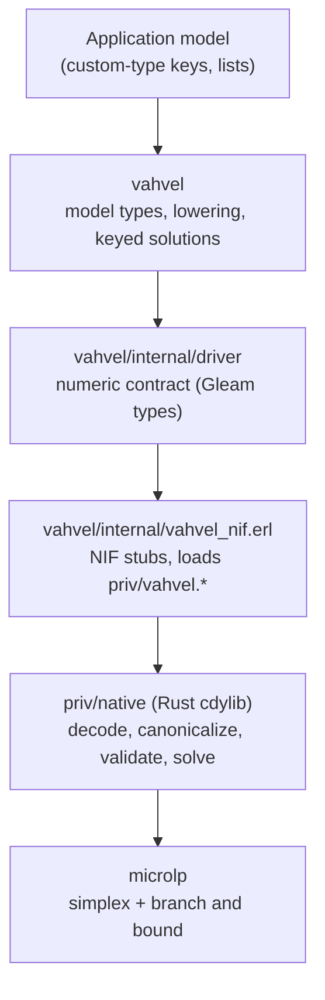

# Vahvel architecture

Vahvel is a Gleam library for linear and mixed-integer linear programming. Gleam
code describes models; a Rust NIF validates and solves them with
[microlp](https://docs.rs/microlp/0.8.0/microlp/). This document describes how the
pieces fit together as they are now. The reasons behind them are in
[DESIGN.md](DESIGN.md); planned work is in [ROADMAP.md](ROADMAP.md).

`vahvel` is the public modeling module and `vahvel/setup` the public build entry
point. Everything below `vahvel/internal` is internal.

## Layers

| Layer | Files | Owns |
| --- | --- | --- |
| Modeling | `src/vahvel.gleam` | Expressions, constraints, objectives and domains; lowering keys to columns; keyed solution queries |
| Numeric driver | `src/vahvel/internal/driver.gleam` | The contract with Rust: domains, unsummed expressions, rows, outcomes, errors |
| Erlang FFI | `src/vahvel/internal/vahvel_nif.erl`, `vahvel_build_ffi.erl` | Loading the shared library and the `nif_not_loaded` fallbacks; OS detection for the build |
| Native | `priv/native/src/lib.rs`, `driver.rs` | Term decoding, canonicalization, validation, solver calls, evaluation |
| Build and setup | `src/vahvel/setup.gleam`, `src/vahvel/internal/build.gleam`, `src/vahvel/internal/version.gleam` | Building the NIF on first load or on demand, version checks |

Each layer only talks to the one below it. The modeling layer never exposes
column numbers to callers, and the native layer never sees names or keys. Gleam
handles keys, columns, domains and structure; Rust does every numeric
operation (DESIGN.md: "Describe in Gleam, compute in Rust").

## Modeling layer

`vahvel.gleam` lowers a keyed model to a `driver.Model` and maps the numeric
result back to keys. The public types' doc comments give the exact semantics;
what matters for the structure:

- Columns follow the order of first reference, objective first, then
  constraints in order. Rows follow constraint order one-to-one.
- Lowering is pure and arithmetic-free. It expands `Variable(key)` to
  `Linear(1.0, key)` and `Difference(lhs, rhs)` to
  `Sum([lhs, Scaled(-1.0, rhs)])`, keeps the tree shape, duplicates and zeros,
  and runs in one tail-recursive loop over an explicit stack of frames.
  `Binary`, `NonNegativeReal` and `NonNegativeInteger` lower to bounded
  `Integer`/`Real` driver domains.
- The column keys stay in Gleam. They turn solver values into a keyed
  `Solution` and driver error positions into keys; row positions map back to
  the constraint values themselves.
- `solve` is `solve_with` with no limits. `solve_with` converts the `Duration`
  to integer seconds and nanoseconds without float arithmetic.
- `evaluate` lowers the expression the same way, calls the lookup once per
  distinct key in first-reference order, stops at the first missing value, and
  sends the indexed expression and values to `driver_evaluate`.
  `evaluate_solution`, `evaluate_dict` and `residual` are one-line calls to it.

## Numeric driver contract

`driver.gleam` defines the IR that crosses the native boundary, and its doc
comments are the contract's reference. Variables are zero-based positions in
`Model.variables`; expressions are unsummed trees of `Linear`, `Constant`,
`Sum` and `Scaled` with repeated indices and zero coefficients allowed. Limits
travel separately from the model. Errors carry positions, which the modeling
layer maps back; invalid domains and non-finite numbers come from user data,
every other invalid-model reason is a producer bug.

This contract is the single numeric interface. A Gleam type change must be
matched in `driver.rs`, and vice versa.

## Native boundary

`driver_solve/2` and `driver_evaluate/2` run on dirty CPU schedulers;
`nif_version` is a trivial NIF for build checks. The rules NIFs follow, and why,
are in DESIGN.md ("NIF rules").

**Term mapping.** Rustler derives decoders that match Gleam's Erlang
representation directly:

| Gleam | Erlang term | Rust derive |
| --- | --- | --- |
| `Minimize`, `LessEqual` (no fields) | `minimize`, `less_equal` | `NifUnitEnum` |
| `Finite(1.0)`, `Integer(Some(0), None)` | `{finite, 1.0}`, `{integer, {some, 0}, none}` | `NifTaggedEnum` |
| `Sum([..])`, `Scaled(2.0, ..)` (one node) | `{sum, [..]}`, `{scaled, 2.0, ..}` | `NifTaggedEnum` (`Node`) with `Term` children |
| `Row(..)`, `Model(..)` | `{row, ..}`, `{model, ..}` | `NifRecord` with `#[tag]` |
| `None`, `Some(value)` (`Option`) | `none`, `{some, Value}` | `NifTaggedEnum` (`Optional<T>`) |
| `Result(a, e)` | `{ok, A}`, `{error, E}` | `Result<T, E>` |

Expressions are never decoded into a nested Rust value: each node's children
stay `Term`s on an explicit stack, so decoding, traversal and drop never
recurse.

**Steps in `driver_solve`.**

1. Decode and check limits, time before nodes. Malformed terms are
   `SolverFailure`; out-of-range values are `InvalidTimeLimit` or
   `InvalidNodeLimit`.
2. Decode each domain, the objective and each row separately, so a failure
   reports its position, and canonicalize them (DESIGN.md:
   "Canonicalization"). The objective becomes a dense vector plus offset; each
   row becomes sorted nonzero terms and a right-hand side. The whole model is
   validated before any outcome is reported.
3. Answer trivial cases directly: an empty domain or an unsatisfiable constant
   row is `Infeasible`; a model with no variables returns its offset.
4. Build a microlp `Problem` and call `solve_with` with only the time and node
   budgets changed from defaults. Infeasible and unbounded errors become
   outcomes; an optimal solution becomes `Optimal`; a feasible solution or an
   interrupted solve becomes `Limited` with or without primal values. Stats
   are copied out and no backend state survives the call.
5. Reject non-finite objectives or values, and compute the relative gap from
   the offset-shifted bound (DESIGN.md: "Solve statistics").

Panics are caught with `catch_unwind` and returned as `SolverFailure`, so the
NIF always answers with a tagged result.

## Build, loading and versions

- The crate lives in `priv/native`: Hex packages ship only `src/` and `priv/`.
  `priv/` also ships in releases, so Cargo builds into the package's `target/`
  (`--target-dir`, mirrored in `priv/native/.cargo/config.toml`; `just` runs
  Cargo inside the crate because `--manifest-path` skips that config).
- Paths come from the installed package, never the working directory. The
  library goes to `code:priv_dir(vahvel)`, where the runtime loads it. Gleam
  links that directory to the package's own `priv/` (for a consumer,
  `build/packages/vahvel/priv`), so the library ships with `gleam export` and
  `gleam clean` removes it. The consumer workflow checks this on each platform.
- `vahvel_nif.erl`'s `on_load` hook builds a missing library
  (`build.ensure_built`), then loads `priv/vahvel`. If the build or load fails,
  the module is not loaded and calls raise `undef`; a failed build prints its
  cause first. The module name must match `rustler::init!` in `lib.rs`.
- `gleam run -m vahvel/setup` also rebuilds a library that fails to load or whose
  `nif_version` differs from `version.package_version`; `--force` always
  rebuilds. `just build` is `setup --force`. Setup fails if a library rebuilt
  after a failed load still won't load.
- The package version lives in `gleam.toml`, `priv/native/Cargo.toml`,
  `priv/native/Cargo.lock` and `src/vahvel/internal/version.gleam`. The
  release workflow bumps them together, and `version_test` checks they agree.

## Testing

All tests are gleeunit tests that go through the real NIF; there are no Rust
unit tests and no mocks. Test files mirror the source tree:
`test/vahvel_test.gleam` (also gleeunit's entry point) covers the public API,
and `test/vahvel/internal/` covers driver contract violations the public API
can't produce (malformed terms, bad indices and limits) and version checks.
`test/examples/` holds the representative models, one per file, including the
README's waffle stand in full.

`test/bench.gleam` is not a test; `just bench` runs it. It solves a sparse
transportation LP at growing sizes and reports vahvel's
overhead per term (wall time minus solver time) and the cost of a `residual`
call. Timings are too noisy for CI, so nothing asserts on them.

## Tooling and CI

- `nix develop` (or direnv) provides Gleam, Erlang/OTP, Rust and just, so CI
  and local builds match. `just` lists the recipes; `just check` runs format
  checks, Clippy with warnings as errors, the native build, and tests.
- `test.yml` runs `just lint` and `just test` in the Nix dev shell on pushes
  and pull requests.
- Releases use three manually triggered workflows, each described in its
  header: `release.yml` bumps, checks, tags and dispatches the others
  explicitly, since pushes made with `GITHUB_TOKEN` trigger no workflows;
  `publish.yml` publishes the tag to Hex and smoke-tests the download;
  `consumer.yml` installs on Linux, macOS and Windows without Nix and never
  blocks a release.
- `CHANGELOG.md` collects entries under `## Unreleased`. `release.yml` renames
  that heading to the new version, uses its entries as the GitHub release
  notes, and refuses to release without any. HexDocs shows it as a page.
- Gleam packs `priv/` regardless of `.gitignore`, so the Hex tarball is always
  exported from a fresh clone; never publish from a working copy with a built
  library.
- Gleam's tarballs are not byte-reproducible (`metadata.config` lists
  dependencies in hash order), so the tag, not a checksum, ties the published
  package to the tested one.
