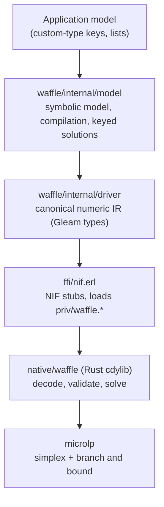
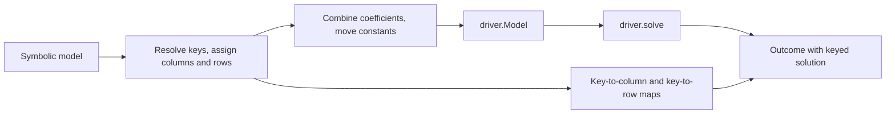

# Waffle architecture

Waffle is a Gleam library for linear and mixed-integer linear programming. Gleam
code describes models; a Rust NIF validates and solves them with
[microlp](https://docs.rs/microlp/0.6.0/microlp/). This document describes how the
pieces fit together. API design decisions and their reasoning are in
[API-DESIGN.md](API-DESIGN.md); planned work is in [ROADMAP.md](ROADMAP.md).

Status: everything below `waffle/internal` is internal. There is no supported
public modeling API yet.

## Layers

| Layer | Files | Owns |
| --- | --- | --- |
| Modeling | `src/waffle/internal/model.gleam` | Symbolic expressions and constraints, key validation, compilation to IR, keyed solution queries |
| Numeric driver | `src/waffle/internal/driver.gleam` | The IR contract: domains, objective vector and offset, sparse rows, outcomes, errors |
| Erlang FFI | `src/waffle/internal/ffi/nif.erl`, `platform.erl` | Loading the shared library and the `nif_not_loaded` fallbacks |
| Native | `native/waffle/src/lib.rs`, `driver.rs` | Term decoding, IR validation, solver calls, result encoding |
| Build and setup | `src/waffle_build.gleam`, `src/waffle_setup.gleam`, `src/waffle/version.gleam` | Compiling the NIF, copying it to `priv/`, version checks |

Each layer only talks to the one below it. The modeling layer never sees column
numbers from the outside, and the native layer never sees names or keys.

## Modeling layer

`model.gleam` turns a symbolic model, written with application-owned keys, into
the numeric IR, and maps the numeric result back to those keys.

Compilation is pure and deterministic: columns follow declaration order, rows
follow constraint order, repeated coefficients are summed, exact zeros dropped,
and sparse indices sorted. The key maps stay in Gleam and are never passed to
the NIF. Solutions are immutable snapshots indexed by the same keys. The API
shape is under active design; see API-DESIGN.md.

## Numeric driver contract

`driver.gleam` defines the IR that crosses the native boundary:

- `Model(direction, variables, objective, offset, rows)`. Variable references
  are zero-based positions in `variables`.
- `Domain` is `Continuous(lower, upper)` with `Unbounded | Finite(Float)` bounds,
  or `Integer(lower, upper)` with inclusive bounds fitting signed 32 bits.
  Binary variables are `Integer(0, 1)`.
- `Row(terms, relation, rhs)` with strictly increasing indices and nonzero
  finite coefficients. An empty row has a left-hand side of zero.
- The objective vector has exactly one finite coefficient per variable. The
  offset is kept separately and added to the reported objective.
- `solve` returns `Ok(Optimal(objective, values) | Infeasible | UnboundedProblem)`
  or `Error(InvalidModel(_) | SolverFailure(_))`. Invalid input is distinct from
  a numerical or internal failure.

This contract is the single numeric interface. Higher layers produce it;
the native layer enforces it.

## Native boundary

`driver_solve` is the only compute NIF. It runs on a dirty CPU scheduler so long
solves don't block normal BEAM schedulers.

**Term mapping.** Rustler derives decoders that match Gleam's Erlang
representation directly:

| Gleam | Erlang term | Rust derive |
| --- | --- | --- |
| `Minimize`, `LessEqual` (no fields) | `minimize`, `less_equal` | `NifUnitEnum` |
| `Finite(1.0)`, `Integer(0, 1)` | `{finite, 1.0}`, `{integer, 0, 1}` | `NifTaggedEnum` |
| `Row(..)`, `Model(..)` | `{row, ..}`, `{model, ..}` | `NifRecord` with `#[tag]` |
| `Result(a, e)` | `{ok, A}`, `{error, E}` | `Result<T, E>` |

A Gleam type change must be matched in `driver.rs`, and vice versa.

**Steps in `driver.rs`.**

1. Decode the term. Malformed terms and integers outside `i32` become
   `InvalidModel`.
2. Validate the whole model before solving: objective length, finite
   coefficients, offsets and bounds, `lower <= upper`, row indices in range and
   strictly increasing, nonzero coefficients. Nothing is clamped, rounded or
   relaxed.
3. Handle empty rows directly: an unsatisfiable constant row means `Infeasible`.
   A model with no variables returns its offset as the optimum.
4. Build a microlp `Problem` and solve. microlp's infeasible and unbounded errors
   become outcomes; any other non-optimal return is a `SolverFailure`.
5. Reject non-finite objective or values instead of returning them to the BEAM.

Solver panics are caught with `catch_unwind` and returned as `SolverFailure`, so
the NIF always answers with a tagged result.

`nif_version` is a second, trivial NIF used for build/version checks.

## Build, loading and versions

- `just build` runs `gleam run -m waffle_build`, which runs
  `cargo build --release` in `native/waffle` and copies the platform library to
  `priv/waffle.{so,dylib,dll}`.
- `gleam run -m waffle_setup` rebuilds only if the library is missing or its
  `nif_version` differs from `waffle/version.package_version`; `--force`
  rebuilds anyway.
- `nif.erl` loads `priv/waffle` in its `on_load` hook. Until it is loaded, every
  stub raises `nif_not_loaded`.
- The package version lives in `gleam.toml`, `native/waffle/Cargo.toml` and
  `src/waffle/version.gleam`. The release workflow bumps all three together, and
  `version_test` checks they agree.
- Linux targets link `libstdc++` statically (`native/waffle/.cargo/config.toml`).

## Testing

All tests are gleeunit tests that go through the real NIF; there are no Rust
unit tests and no mocks.

- `test/driver_test.gleam`: the numeric contract, covering continuous and
  integer solves, offsets, infeasible and unbounded outcomes, constant models,
  and rejection of invalid IR (dimensions, indices, ordering, bounds, overflow,
  malformed terms).
- `test/model_test.gleam`: representative models (production, transportation,
  binary selection), canonical compilation, key validation, and outcomes.
- `test/version_test.gleam`: NIF and package versions match.

## Tooling and CI

- `nix develop` (or direnv) provides Gleam, Erlang/OTP, Rust and just. The flake
  also supplies the native build toolchain, so CI and local builds match.
- `just` runs format checks, Clippy with warnings as errors, the native build,
  and tests. `just fmt` formats Gleam and Rust.
- `.github/workflows/test.yml` runs `just lint` and `just test` in the Nix dev
  shell on pushes and pull requests.
- `.github/workflows/release.yml` is manually triggered: it bumps the version,
  runs the checks, tags, and attaches a Linux x86_64 library to the GitHub
  release. That binary is built in Nix and may depend on Nix runtime paths, so
  it is not a portable prebuilt artifact; a cross-platform matrix is sketched
  in the workflow but not enabled.
