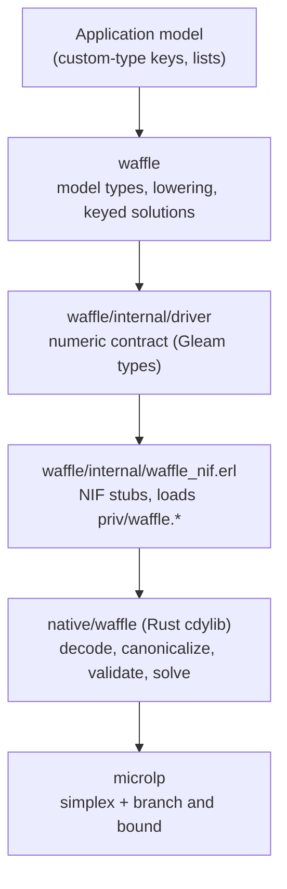
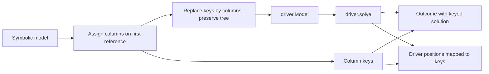

# Waffle architecture

Waffle is a Gleam library for linear and mixed-integer linear programming. Gleam
code describes models; a Rust NIF validates and solves them with
[microlp](https://docs.rs/microlp/0.6.0/microlp/). This document describes how the
pieces fit together as they are now. The reasons behind them are in
[DESIGN.md](DESIGN.md); planned work is in [ROADMAP.md](ROADMAP.md).

Status: `waffle` is the public modeling module and is unstable while the
package is 0.x. `waffle/setup` is the public build entry point. Everything below
`waffle/internal` is internal.

## Layers

| Layer | Files | Owns |
| --- | --- | --- |
| Modeling | `src/waffle.gleam` | Expressions, constraints, objectives and domains; lowering keys to columns; keyed solution queries |
| Numeric driver | `src/waffle/internal/driver.gleam` | The contract with Rust: domains, unsummed expressions, rows, outcomes, errors |
| Erlang FFI | `src/waffle/internal/waffle_nif.erl`, `waffle_build_ffi.erl` | Loading the shared library and the `nif_not_loaded` fallbacks; OS detection for the build |
| Native | `native/waffle/src/lib.rs`, `driver.rs` | Term decoding, canonicalization, validation, solver calls, evaluation |
| Build and setup | `src/waffle/setup.gleam`, `src/waffle/internal/build.gleam`, `src/waffle/internal/version.gleam` | Compiling the NIF, copying it to `priv/`, version checks |

Every `.erl` file is prefixed with `waffle_` (DESIGN.md: "NIF rules").

Each layer only talks to the one below it. The modeling layer never sees column
numbers from the outside, and the native layer never sees names or keys.

Gleam handles keys, columns, domains and structure; Rust does every numeric
operation: canonicalization, validation, solving, evaluation. The modeling layer
contains no float arithmetic (DESIGN.md: "Describe in Gleam, compute in Rust").

## Modeling layer

`waffle.gleam` turns a symbolic model, written with application-owned keys, into
the driver model, and maps the numeric result back to those keys. Expressions are
affine trees (`Variable(key)`, `Linear(coefficient, key)`, `Constant(value)`,
`Sum(expressions)`, `Difference(lhs, rhs)` or `Scaled(coefficient, expression)`),
and constraints relate two expressions (`LessEqual`, `Equal`, `GreaterEqual`).
A variable exists once an expression references it; the model's `domain`
function gives each variable's bounds and integrality.

Compilation is pure, deterministic and arithmetic-free: columns follow the order
of first reference (objective, then constraints), rows follow constraint order,
and keys become column indices. Lowering expands `Variable(key)` to
`Linear(1.0, key)` and `Difference(lhs, rhs)` to `Sum([lhs, Scaled(-1.0, rhs)])`.
It preserves the expanded tree shape and depth-first order of leaves, including
duplicates and zeros, in one tail-recursive loop over an explicit stack of
frames. Cancellation never removes a reference during lowering. Scaling and
summing happen in Rust. `Binary` lowers to the same integer
domain as `Integer(Some(0), Some(1))`; `NonNegativeReal` lowers to
`Real(Some(0.0), None)` and `NonNegativeInteger` to `Integer(Some(0), None)`.
The column keys stay in Gleam and are never passed to the NIF; they turn
solver values into a keyed solution and driver error positions into keys. Row
positions map back to the constraints themselves, so a `SolveError` names what
the caller wrote. Solutions are immutable assignments indexed by the same keys.
Outcomes carry the driver's statistics with solver time as a `Duration`:
`Optimal(solution, stats)` or `Limited(reason, optional_solution, stats)`,
alongside `Infeasible` and `Unbounded`. `stats(outcome)` returns an option; the
latter two have none. `solve` supplies unlimited budgets to `solve_with`; the
latter lowers optional time to integer seconds/nanoseconds and passes node
counts unchanged. `evaluate` lowers an expression the same way, calls the
caller's lookup once per distinct key in first-reference order and stops at
the first missing value, then sends the indexed expression and values to
`driver_evaluate`, which shares canonicalization with solving before
multiplying by the values. `evaluate_solution` and `evaluate_dict` pass
`value(solution, _)` and `dict.get(values, _)` as the lookup, and `residual`
evaluates `Difference(lhs, rhs)` of a constraint.

## Numeric driver contract

`driver.gleam` defines the IR that crosses the native boundary:

- `Model(direction, variables, objective, rows)`. Variable references are
  zero-based positions in `variables`.
- `Expression` is `Linear(coefficient, index)`, `Constant(value)`,
  `Sum(expressions)` or `Scaled(coefficient, expression)`, nested to any depth.
  Indices may repeat and coefficients may be zero. The objective's constants
  are its offset.
- `Domain` is `Real(lower, upper)` with `Unbounded | Finite(Float)` bounds,
  or `Integer(lower, upper)` with inclusive `Option(Int)` bounds fitting signed
  32 bits; Rust turns `None` into `i32::MIN`/`i32::MAX`, microlp's integer
  range. Binary variables are `Integer(Some(0), Some(1))`. A domain with
  `lower > upper` is valid but empty and makes the model infeasible.
- `Row(lhs, relation, rhs)` relates two expressions.
- `Limits(time: Option(#(Int, Int)), nodes: Option(Int))` travels separately
  from the model. Time is normalized seconds/nanoseconds, not the representation
  of Gleam's opaque `Duration`. `None` is unlimited; zero is permitted.
- `solve(model, limits)` returns `Ok(Optimal(objective, values, stats) |
  Limited(reason, primal, stats) | Infeasible | UnboundedProblem)` or an error.
  `primal` is `Option(#(Float, List(Float)))`, with a full objective and values
  in column order. Reasons are `TimeLimit | NodeLimit`.
- `Stats(nodes, iterations, nanoseconds, gap)` carries backend work counters and
  elapsed solver time; counters/time are zero for trivial optima. The optional
  relative gap uses Waffle's objective offset (DESIGN.md: "Solve statistics").
- Errors are `InvalidTimeLimit`, `InvalidNodeLimit`,
  `InvalidModel(reason)` or `SolverFailure(_)`. Malformed limits are contract
  failures. Invalid model reasons remain `MalformedModel`, `InvalidObjective`,
  `InvalidDomain(variable)`, `InvalidRow(row)`, `NonFiniteObjective` and
  `NonFiniteRow(row)`. Positions are zero-based and mapped to keys/constraints
  by the modeling layer. Non-finite reasons and invalid domains identify user
  data; the other model reasons indicate a producer bug.

This contract is the single numeric interface. Higher layers produce it;
the native layer canonicalizes and enforces it.

## Native boundary

`driver_solve/2` validates budgets, canonicalizes, validates and solves a model
on a dirty CPU scheduler. `driver_evaluate` canonicalizes an indexed expression
by the same rules and computes its value at the supplied values, returning
`Error(Nil)` for an invalid expression or non-finite arithmetic. It also runs on
a dirty CPU scheduler because decoding and sorting are unrestricted work. The
rules NIFs follow are in DESIGN.md ("NIF rules").

**Term mapping.** Rustler derives decoders that match Gleam's Erlang
representation directly:

| Gleam | Erlang term | Rust derive |
| --- | --- | --- |
| `Minimize`, `LessEqual` (no fields) | `minimize`, `less_equal` | `NifUnitEnum` |
| `Finite(1.0)`, `Integer(Some(0), None)` | `{finite, 1.0}`, `{integer, {some, 0}, none}` | `NifTaggedEnum` |
| `Sum([..])`, `Scaled(2.0, ..)` (one node) | `{sum, [..]}`, `{scaled, 2.0, ..}` | `NifTaggedEnum` (`Node`) with `Term` children |
| `Row(..)`, `Model(..)` | `{row, ..}`, `{model, ..}` | `NifRecord` with `#[tag]` |
| `None`, `Some(value)` (`Option`) | `none`, `{some, Value}` | `NifTaggedEnum` (`Optional<T>` for limits/results, `IntegerBound` for domains) |
| `Result(a, e)` | `{ok, A}`, `{error, E}` | `Result<T, E>` |

A Gleam type change must be matched in `driver.rs`, and vice versa. Expressions
are never decoded into a nested Rust value: each node's children stay `Term`s
on an explicit stack, so decoding, traversal and drop never recurse.

**Steps in `driver.rs`.**

1. Decode limits, checking time first and nodes second. Non-integer fields or
   malformed tags are contract failures; negative/out-of-range integers are
   typed invalid-limit errors. Time is at most 100 years (DESIGN.md: "Solve
   limits"); nodes fit `u64`. Then decode the model shell, each variable
   domain, the objective and each row separately, so a failure reports its
   position. A term that isn't a model is `MalformedModel`; integer bounds
   outside `i32` are `InvalidDomain(i)`.
2. Canonicalize the objective and each row (`lhs − rhs`) by the rules in
   DESIGN.md ("Canonicalization"): expand the tree depth-first, multiplying
   scale factors into leaves; stable-sort terms by index, sum duplicates and
   constants in input order, then drop zeros. Every product and sum is checked. Overflow becomes infinity in
   `f64` and is reported as `NonFiniteObjective`/`NonFiniteRow(i)`; a malformed
   node or an index out of range is `InvalidObjective`/`InvalidRow(i)`. The
   objective becomes a dense vector plus offset; each row becomes sorted
   nonzero terms and a right-hand side. Everything is validated before solving,
   and nothing is clamped, rounded or relaxed.
3. Answer trivial cases directly: an empty domain or an unsatisfiable constant
   row means `Infeasible`; a model with no variables returns its offset as the
   optimum.
4. Build a microlp `Problem` and call `solve_with`, changing only time and node
   budgets from defaults. Time covers this backend call and can overshoot
   between checks; node budgets exclude the root relaxation. Infeasible and
   unbounded errors become proof outcomes. Optimal solutions become `Optimal`;
   feasible solutions and `InterruptedSolve` become `Limited` with and without
   primal values respectively. Copy stats before dropping all backend state;
   no resume resource survives the call. Unexpected reasons remain failures.
5. Reject non-finite primal objectives or values on both solution paths. Shift
   the best bound by the objective offset and compute the relative gap in Rust;
   unavailable or non-finite diagnostic arithmetic yields `None`. Only the
   backend's proof status determines `Optimal`.

Solver panics are caught with `catch_unwind` and returned as `SolverFailure`, so
the NIF always answers with a tagged result.

`nif_version` is a trivial NIF used for build/version checks.

## Build, loading and versions

- `just build` runs `gleam run -m waffle/internal/build`, which runs
  `cargo build --release` in `native/waffle` and copies the platform library to
  `priv/waffle.{so,dylib,dll}`.
- `gleam run -m waffle/setup` rebuilds only if the library is missing or its
  `nif_version` differs from `waffle/internal/version.package_version`;
  `--force` rebuilds anyway.
- `waffle_nif.erl` loads `priv/waffle` in its `on_load` hook. Until it is
  loaded, every stub raises `nif_not_loaded`. Its module name must match
  `rustler::init!` in `lib.rs`.
- The package version lives in `gleam.toml`, `native/waffle/Cargo.toml` and
  `src/waffle/internal/version.gleam`. The release workflow bumps all three
  together, and `version_test` checks they agree.
- Linux targets link `libstdc++` statically (`native/waffle/.cargo/config.toml`).

## Testing

All tests are gleeunit tests that go through the real NIF; there are no Rust
unit tests and no mocks.

Test files mirror the source tree, so test modules are namespaced too, except
for the representative models in `test/examples/`.

- `test/waffle_test.gleam`: gleeunit's entry point and the modeling API,
  grouped by concern: variables and keys, domains, constraints, expressions,
  outcomes and errors, solutions, evaluation against supplied values,
  residuals, statistics, budgets, incumbent availability, validation precedence
  and offset-aware gaps.
- `test/examples/`: representative models. `readme_test` is the README's waffle
  stand in full, one test per step, ending with a hand-made plan;
  `production_network_test` is a multi-period network with mixed variable
  families, sparse routes, cost breakdowns, a complete plan by period mixing
  lookups and residuals, a what-if over solution values and a scenario,
  generated by size; `n_queens_test` is a small binary model built from index
  sets.
- `test/waffle/internal/driver_test.gleam`: the numeric contract, covering
  real and integer domains, canonicalization, offsets, infeasible and
  unbounded outcomes, constant models, positioned errors, non-finite sums,
  malformed terms and expressions, and `evaluate`.
- `test/waffle/internal/version_test.gleam`: NIF and package versions match.
- `test/bench.gleam`: not a test; `just bench` runs it. It solves the
  production network's LP relaxation at growing sizes and reports wall time,
  solver time and their difference (waffle's overhead) per term, plus the cost
  of one `residual` call, as median and range over repeated runs after
  warm-up. Timings are too noisy for CI, so nothing asserts on them.

## Tooling and CI

- `nix develop` (or direnv) provides Gleam, Erlang/OTP, Rust and just. The flake
  also supplies the native build toolchain, so CI and local builds match.
- `just` runs format checks, Clippy with warnings as errors, the native build,
  and tests. `just fmt` formats Gleam and Rust.
- `.github/workflows/test.yml` runs `just lint` and `just test` in the Nix dev
  shell on pushes and pull requests.
- `.github/workflows/release.yml` is manually triggered: it bumps the version,
  runs the checks, tags, and attaches a Linux x86_64 library to the GitHub
  release. That binary is built in Nix and may depend on Nix runtime paths, so
  it is not a portable prebuilt artifact; a cross-platform matrix is sketched
  in the workflow but not enabled.
