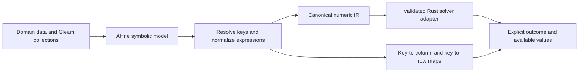

# Waffle architecture proposal

Status: experimental design and throwaway PoC, not a stable public API.

## Intent

Start the roadmap with representative LP/MILP models and use them to discover a
small, idiomatic Gleam modeling API. Users should express decisions and equations
with custom types, lists, functions, pipelines, and exhaustive pattern matching.
They should not manage solver column numbers or reproduce Julia macros in Gleam.

The existing numeric driver is the foundation: sparse rows, explicit domains,
objective coefficients and offset, validated by a dirty CPU Rustler NIF. Preserve
that contract while exploring the modeling layer independently.

## Representative models

| Model | Decisions and constraints | What it tests |
| --- | --- | --- |
| Production LP | Product quantities, resource capacity, profit | Scalar composition, bounds, objective offset, named results |
| Transportation LP | Shipments on allowed routes, supply and demand | Tuple/custom-type keys, sparse index sets, grouped sums, equality rows |
| Binary selection MILP | Choose items within a weight budget | Functional construction, binary domains, integrality |
| Degenerate/invalid models | Empty sums, cancelling terms, unknown keys, duplicate declarations | Validation and explicit outcomes |

The PoC tests are executable model examples. A transportation model should be
built from allowed routes, not a dense Cartesian product followed by filtering.
No performance claim follows from these small examples.

## Approaches

1. **Direct matrix/row generators.** Simple compilation and useful for imported
   numeric models, but exposes ordering, coefficient aggregation, and matrix
   dimensions to application code. Retain this internally; do not make it the
   primary modeling interface.
2. **General symbolic AST.** Supports arbitrary expression syntax and future
   rewrites, but accepts nonlinear expressions that today's solver cannot handle.
   It also introduces degree analysis and more validation before delivering LPs.
3. **Restricted affine expressions (recommended for this experiment).** An opaque
   `Expression(key)` with constants, references, scaling, and sums. This may be
   represented as an affine AST, then lowered once into sparse rows. In a stable
   affine-only interface, multiplying two expressions would be absent. A future
   quadratic type can extend capabilities explicitly without reinterpreting
   existing affine expressions.

The user requested exploring both affine construction and general AST operations
in this PoC. Accordingly, the experiment exposes `multiply` on the same opaque
expression type and rejects unsupported products during compilation. This is an
intentional weakening of the proposed affine-only interface's compile-time
guarantee, so the ergonomics and diagnostics can be evaluated before deciding.
Neither interface is a user-approved stable API.
Symbolic modeling and sparse matrices are complementary layers, not alternatives.
The PoC uses an affine AST to preserve composition until compilation. A canonical
coefficient map is another possible internal representation; benchmark before
choosing permanently. N-ary `sum` avoids a deep tree; pipelined `add` still
builds a left-deep one, so lowering merges the smaller coefficient map into the
larger to keep long chains near-linear.
This general AST experiment includes multiplication, not division, functions,
automatic differentiation, or a nonlinear backend. A product is accepted when at
least one lowered operand has no nonzero variable coefficients. A nonlinear child
is rejected before an outer zero or cancellation is considered: `0 * (x * x)` is
unsupported, while `(x - x) * x` lowers to zero. No polynomial simplification or
quadratic-to-linear approximation is attempted.

## Gleam-facing model

Use pure constructors and immutable model values. Pure expression operations do
not return `Result` at every addition; compilation resolves symbols and reports
invalid models. Operations that can fail use typed errors and `use result.try`.
Public types/functions must be documented; opaque types hide representation.

For the first experiment, references are application-owned keys of a generic
Gleam type. Prefer domain keys such as `Product(ProductId)` or
`Shipment(Factory, Customer)` over strings and integer column numbers. Variable
and constraint keys have separate generic parameters. Declaration order determines
IR order; dictionary iteration never determines column or row order.

Keys are names within the supplied model, not globally unique model handles.
An expression deliberately resolves against the model being compiled. The same
key can be reused across scenarios; passing a different model with that key does
not constitute a detectable ownership error. Unknown keys and duplicate
registrations are errors. This avoids mutable allocation and branch-dependent
integer handle collisions, but cannot catch accidental same-key reuse across
models. Before stabilizing, compare this with opaque runtime-identified handles
on models assembled from independent components. Do not claim phantom types alone
provide fresh per-model identities in Gleam.

Keep one experimental module while responsibilities remain small. A production
split should follow real boundaries: expression algebra, model validation and
compilation, and solution queries. Do not create forwarding modules merely to
imitate another library's namespace.

## Collections and index sets

Use ordinary `List`, `Dict`, custom types and tuples. `list.map` builds terms and
constraints; `list.filter` selects allowed combinations; `list.fold` accumulates
models; an expression `sum` consumes a list and defines the empty sum as zero.
Use `list.group` or a precomputed adjacency dictionary for repeated network sums;
repeatedly filtering every route for every node scales poorly.

No tensor broadcasting, bespoke index-set DSL, magic attribute lookup, or implicit
zip truncation. A later indexed declaration helper should reject duplicate keys
rather than inheriting `dict.from_list`'s replacement behavior. If a dot-product
helper accepts two lists, unequal lengths must be an error. A list of keyed
coefficient records is often clearer and avoids parallel-array mismatches.

## Compilation and IR



Compilation assigns columns in declaration order, resolves every reference,
combines repeated coefficients, drops exact zeros, and sorts sparse indices.
For `lhs relation rhs`, lower `lhs - rhs` and move its constant to the numeric
right-hand side. Preserve the objective constant separately. Do not drop small
nonzero coefficients with a heuristic epsilon. Validate references even inside
zero-scaled or cancelling expressions so invalid references cannot disappear.

Keep names, provenance, and result maps on the Gleam side. They are not solver
inputs. Preserve row identities when implementing transformations: splitting or
scaling rows requires a reverse map for dual recovery. The PoC does no such row
transformations beyond moving constants and collecting coefficients.

The NIF remains the authoritative defensive boundary for finite numbers, domain
bounds, integer range, sorted sparse rows, dimensions, and finite results. No
clamping, integrality relaxation, or unchecked native assumptions. The experiment
relies on that existing numeric validation when solving; a stable standalone
compiler must additionally provide contextual numeric errors before native calls.
Arithmetic overflow during symbolic evaluation also needs a tagged error before
stabilization: BEAM float operations can fail before the NIF sees the model.

## Outcomes and querying

The PoC exposes `Optimal(solution)`, `Infeasible`, and `Unbounded` separately from
`Result` errors. Only the optimal constructor carries a primal solution. Query
values using the same application key, returning an error for an unknown key.
Solutions are immutable snapshots, independent of subsequent model construction.

When solve limits are added, separate *why solving stopped* from *what data is
available*. A future outcome should distinguish optimal, feasible-but-unproven,
and stopped-without-primal-value states. A time limit is not infeasibility, and a
feasible incumbent is not optimal. Do not add unreachable status variants to the
PoC merely to resemble other APIs. The current driver intentionally treats an
unexpected non-optimal native return as a solver failure; limits require changing
that driver contract and its Rust encoding together. microlp 0.6.0 already
provides `set_time_limit`, `solve_with`, `TerminationReason`, `InterruptedSolve`
and `resume`; an interrupted solve currently lands in the driver's generic
non-optimal branch.

### Dual values

microlp 0.6.0 exposes primal values, status, gap and statistics, but no public
constraint-dual accessor. The current NIF therefore cannot provide native duals.
An explicit unavailable result is preferable to zero, NaN, or invented prices.
The PoC checks that a constraint key exists and reports backend unavailability.

For a supporting LP backend, expose typed availability and keyed dual queries,
including reasons such as unsupported backend, unavailable result, and integer
model. Keep primal and dual availability independent. MILP incumbents do not
carry ordinary LP shadow prices; solving a relaxation or fixing integer decisions
is a distinct, explicitly requested model with different economic meaning.

Before shipping duals, specify whether values are Lagrange multipliers or objective
sensitivity to RHS changes; define signs for each relation and objective direction,
bound duals/reduced costs, and transformations back to original rows. Verify
analytic LPs, KKT conditions, and controlled RHS perturbations. A future explicit
dual-model construction could use microlp, but is outside this PoC and would need
its own transformation and validation tests.

## Scope and acceptance

The requested PoC is disposable exploration under `waffle/internal`, not a new
supported public package surface. It should demonstrate affine construction,
functional indexed modeling, deterministic canonical compilation, real-NIF LP and
MILP solving, explicit outcomes, keyed primal lookup, and honest unavailable duals.
Tests should cover objective offsets, constraints with expressions on both sides,
repeated/cancelling terms, duplicates, undeclared keys, empty models, infeasible and
unbounded models, and invalid domains through the real NIF.

### Executable usage and findings

The implementation is in `src/waffle/internal/model_poc.gleam`; runnable examples
are in `test/model_poc_test.gleam`. Run `just test` to exercise the real NIF.
For example, the same objective can be written through the affine operations:

```gleam
let profit = chair
  |> m.scale(3.0)
  |> m.add(m.scale(table, 2.0))
  |> m.add(m.constant(7.0))
```

or the experimental general AST:

```gleam
let profit = m.sum([
  m.multiply(m.constant(3.0), chair),
  m.multiply(table, m.add(m.constant(1.0), m.constant(1.0))),
  m.constant(7.0),
])
```

Both compile to identical numeric IR and solve the production example to 17.0.
The transportation example solves to cost 7.0; binary selection solves to value
6.0, preserving integer domains. The examples use custom-type and tuple keys,
ordinary `list.map`/`list.filter`, exhaustive outcomes, and keyed solution queries.
The small transportation example uses filtering for readability; large networks
should use precomputed groups as described above.

Initial finding: general AST operations are straightforward to represent, but
their main cost is semantic ambiguity and delayed rejection, not syntax alone.
The affine path is shorter for numeric coefficients. Retain this experimental
comparison for review; defer broader nonlinear operations to a separate roadmap
item unless a representative model establishes their benefit.

This is a correctness and ergonomics spike. Compilation recursively traverses
the tree and merges maps; deep/shared trees and large-scale performance have not
been tested. There is no expression printer or detailed expression-location
diagnostic yet. Generic `NonlinearExpression` is sufficient to demonstrate the
boundary, but insufficient for a polished modeling API. Domain types currently
come directly from the internal driver; a supported API must own its domain
types without requiring users to import internal modules.

No solver replacement, nonlinear support, QP implementation, automatic solver
selection, solve limits, persistent native model resources, or performance promises
in this step. Keep Rust unchanged. Run `just fmt` and `just` for the PoC.

Next decisions after reviewing the executable examples: key-based references versus
allocated handles; affine AST versus coefficient map construction cost; contextual
numeric diagnostics; larger sparse model construction benchmarks; then solve-limit
and dual-capable backend contracts. Quadratic/conic IR should be an explicit future
capability, not squeezed into the present linear row format.

## Research

Reviewed 2026-10-23. These are design influences, not interfaces to copy.

- [JuMP expressions](https://jump.dev/JuMP.jl/stable/manual/expressions/): specialized
  affine/quadratic expression representations motivate capability-specific types.
  JuMP also has a general `NonlinearExpr` tree and promotes products to a richer
  expression type rather than rejecting them, a counterpoint to compile-time
  rejection in this PoC.
- [Pyomo sets](https://pyomo.readthedocs.io/en/stable/explanation/modeling/math_programming/sets.html):
  indexed and sparse sets motivate domain-driven collections; Gleam already has
  the functional primitives needed for the first iteration.
- [MathOpt](https://developers.google.com/optimization/math_opt): separates modeling
  from solving and supports solver-independent models.
- [MathOpt result contract](https://developers.google.com/optimization/service/reference/rest/v1/mathopt/solveMathOptModel):
  termination, primal results, and dual results are distinct concepts.
- [JuMP solutions](https://jump.dev/JuMP.jl/stable/manual/solutions/): availability
  must be checked independently of termination, and certificates differ from values.
- [microlp 0.6.0 Solution](https://docs.rs/microlp/0.6.0/microlp/struct.Solution.html):
  current backend capabilities and absence of a public dual accessor; time limits
  and interrupted/resumable solves are already supported by the crate.
- [Gleam opaque types](https://tour.gleam.run/advanced-features/opaque-types/):
  hide expression representation while preserving a small typed API.
