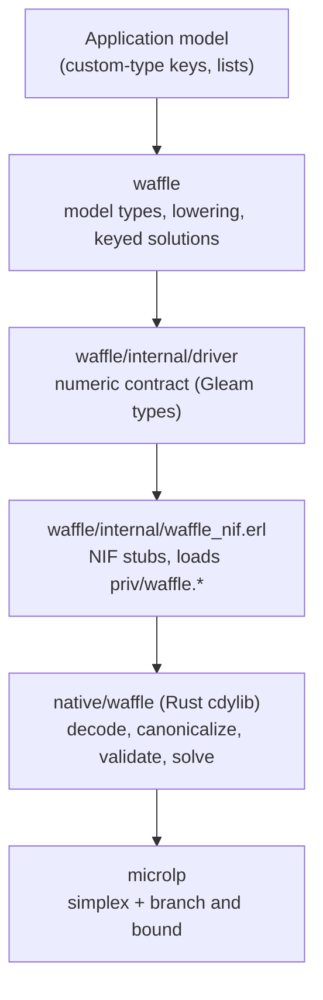

# Waffle architecture

Waffle is a Gleam library for linear and mixed-integer linear programming. Gleam
code describes models; a Rust NIF validates and solves them with
[microlp](https://docs.rs/microlp/0.6.0/microlp/). This document describes how the
pieces fit together. API design decisions and their reasoning are in
[API-DESIGN.md](API-DESIGN.md); planned work is in [ROADMAP.md](ROADMAP.md).

Status: `waffle` is the public modeling module and is unstable while the
package is 0.x. `waffle/setup` is the public build entry point. Everything below
`waffle/internal` is internal.

## Layers

| Layer | Files | Owns |
| --- | --- | --- |
| Modeling | `src/waffle.gleam` | Terms, constraints, objectives and domains; lowering keys to columns; keyed solution queries |
| Numeric driver | `src/waffle/internal/driver.gleam` | The contract with Rust: domains, unsummed expressions, rows, outcomes, errors |
| Erlang FFI | `src/waffle/internal/waffle_nif.erl`, `waffle_build_ffi.erl` | Loading the shared library and the `nif_not_loaded` fallbacks; OS detection for the build |
| Native | `native/waffle/src/lib.rs`, `driver.rs` | Term decoding, canonicalization, validation, solver calls, evaluation |
| Build and setup | `src/waffle/setup.gleam`, `src/waffle/internal/build.gleam`, `src/waffle/internal/version.gleam` | Compiling the NIF, copying it to `priv/`, version checks |

Erlang modules share one global namespace and take their name from `-module`,
not their path, so every `.erl` file is prefixed with `waffle_`.

Each layer only talks to the one below it. The modeling layer never sees column
numbers from the outside, and the native layer never sees names or keys.

**Guiding rule: describe in Gleam, compute in Rust** (API-DESIGN D1). Gleam
handles keys, columns, domains and structure; Rust does every numeric
operation: canonicalization, validation, solving, evaluation. This keeps the
modeling layer identical across targets (BEAM floats can't overflow silently,
JS floats can) and puts the expensive work where it is fast. The modeling layer
contains no float arithmetic at all.

Intended direction: when a JS target arrives via WASM, the Rust code splits into
a target-independent engine (canonicalize, validate, solve) and thin adapters
(Rustler for the BEAM, wasm-bindgen for JS). The engine only ever sees indices,
never Gleam keys.

## Modeling layer

`waffle.gleam` turns a symbolic model, written with application-owned keys, into
the driver model, and maps the numeric result back to those keys. Expressions are
plain lists of terms (`Linear(coefficient, key)` or `Constant(value)`), and
constraints relate two expressions (`LessEqual`, `Equal`, `GreaterEqual`). A
variable exists once an expression references it; the model's `domain`
function gives each variable's bounds and integrality.

Compilation is pure, deterministic and arithmetic-free: columns follow the order
of first reference (objective, then constraints), rows follow constraint order,
and each term list becomes an indexed `Expression(terms, constants)` with terms
in their original order, duplicates and zeros included. Summing happens in Rust.
The column keys stay in Gleam
and are never passed to the NIF; they turn solver values into a keyed solution
and driver error positions into keys. Solutions are immutable snapshots indexed
by the same keys. The API shape is
under active design; see API-DESIGN.md.

## Numeric driver contract

`driver.gleam` defines the IR that crosses the native boundary:

- `Model(direction, variables, objective, rows)`. Variable references are
  zero-based positions in `variables`.
- `Expression(terms, constants)` is `Σ coefficient · x[index] + Σ constants`.
  It is not canonical: indices may repeat, appear in any order and carry zero
  coefficients. The objective's constants are its offset.
- `Domain` is `Continuous(lower, upper)` with `Unbounded | Finite(Float)` bounds,
  or `Integer(lower, upper)` with inclusive `Option(Int)` bounds fitting signed
  32 bits; Rust turns `None` into `i32::MIN`/`i32::MAX`, microlp's integer
  range. Binary variables are `Integer(Some(0), Some(1))`. A domain with `lower > upper` is valid
  but empty and makes the model infeasible.
- `Row(lhs, relation, rhs)` relates two expressions.
- `solve` returns `Ok(Optimal(objective, values) | Infeasible | UnboundedProblem)`
  or `Error(InvalidModel(reason) | SolverFailure(_))`. Invalid input is distinct
  from a numerical or internal failure. The reason says where:
  `MalformedModel`, `InvalidObjective`, `InvalidDomain(variable)`,
  `InvalidRow(row)`, `NonFiniteObjective` or `NonFiniteRow(row)`, with
  zero-based positions that higher layers map back to their own names. The
  non-finite reasons are user data (an overflowing sum, or non-finite input on a
  target that allows it); the others, apart from domains, indicate a bug in the
  producer.

This contract is the single numeric interface. Higher layers produce it;
the native layer canonicalizes and enforces it.

## Native boundary

`driver_solve` canonicalizes, validates and solves a model. It runs on a dirty
CPU scheduler so long solves don't block normal BEAM schedulers.
`driver_evaluate` computes `Σ coefficient · value + Σ constants` for one
expression at a solution (the modeling layer looks up the values first) and
returns `Error(Nil)` for a non-finite result. Its work is small and linear, so it
runs on a normal scheduler.

**Term mapping.** Rustler derives decoders that match Gleam's Erlang
representation directly:

| Gleam | Erlang term | Rust derive |
| --- | --- | --- |
| `Minimize`, `LessEqual` (no fields) | `minimize`, `less_equal` | `NifUnitEnum` |
| `Finite(1.0)`, `Integer(0, 1)` | `{finite, 1.0}`, `{integer, 0, 1}` | `NifTaggedEnum` |
| `Row(..)`, `Expression(..)`, `Model(..)` | `{row, ..}`, `{expression, ..}`, `{model, ..}` | `NifRecord` with `#[tag]` |
| `None`, `Some(1)` (`Option(Int)`) | `none`, `{some, 1}` | `NifTaggedEnum` (`IntegerBound`) |
| `Result(a, e)` | `{ok, A}`, `{error, E}` | `Result<T, E>` |

A Gleam type change must be matched in `driver.rs`, and vice versa.

**Steps in `driver.rs`.**

1. Decode the model shell, then each variable domain, the objective and each
   row separately, so a failure reports its position. A term that isn't a model
   is `MalformedModel`; integer bounds outside `i32` are `InvalidDomain(i)`.
2. Canonicalize the objective and each row (`lhs − rhs`): collect terms, stable
   sort by index, sum duplicates in input order, sum constants, check every sum
   is finite, then drop zeros. Overflow becomes infinity in `f64` and is
   reported as `NonFiniteObjective`/`NonFiniteRow(i)`; an index out of range is
   `InvalidObjective`/`InvalidRow(i)`. The objective becomes a dense vector plus
   offset; each row becomes sorted nonzero terms and a right-hand side.
   Everything is validated before solving, and nothing is clamped, rounded or
   relaxed.
3. Answer trivial cases directly: an empty domain or an unsatisfiable constant
   row means `Infeasible`; a model with no variables returns its offset as the
   optimum.
4. Build a microlp `Problem` and solve. microlp's infeasible and unbounded errors
   become outcomes; any other non-optimal return is a `SolverFailure`.
5. Reject non-finite objective or values instead of returning them to the BEAM.

Solver panics are caught with `catch_unwind` and returned as `SolverFailure`, so
the NIF always answers with a tagged result.

Sums start from `0.0` and follow input order; Rust's `Iterator::sum` for `f64`
starts from `-0.0`, which would make empty sums `-0.0`.

`nif_version` is a trivial NIF used for build/version checks.

## Build, loading and versions

- `just build` runs `gleam run -m waffle/internal/build`, which runs
  `cargo build --release` in `native/waffle` and copies the platform library to
  `priv/waffle.{so,dylib,dll}`.
- `gleam run -m waffle/setup` rebuilds only if the library is missing or its
  `nif_version` differs from `waffle/internal/version.package_version`;
  `--force` rebuilds anyway.
- `waffle_nif.erl` loads `priv/waffle` in its `on_load` hook. Until it is
  loaded, every stub raises `nif_not_loaded`. Its module name must match
  `rustler::init!` in `lib.rs`.
- The package version lives in `gleam.toml`, `native/waffle/Cargo.toml` and
  `src/waffle/internal/version.gleam`. The release workflow bumps all three
  together, and `version_test` checks they agree.
- Linux targets link `libstdc++` statically (`native/waffle/.cargo/config.toml`).

## Testing

All tests are gleeunit tests that go through the real NIF; there are no Rust
unit tests and no mocks.

Test files mirror the source tree, so test modules are namespaced too.

- `test/waffle_test.gleam`: gleeunit's entry point and the modeling API:
  representative models (production, transportation, binary selection),
  constants and terms on both sides, domains, outcomes, non-finite errors, and
  solution queries.
- `test/waffle/internal/driver_test.gleam`: the numeric contract, covering
  continuous and integer solves, canonicalization, offsets, infeasible and
  unbounded outcomes, constant models, positioned errors, non-finite sums,
  malformed terms, and `evaluate`.
- `test/waffle/internal/version_test.gleam`: NIF and package versions match.

## Tooling and CI

- `nix develop` (or direnv) provides Gleam, Erlang/OTP, Rust and just. The flake
  also supplies the native build toolchain, so CI and local builds match.
- `just` runs format checks, Clippy with warnings as errors, the native build,
  and tests. `just fmt` formats Gleam and Rust.
- `.github/workflows/test.yml` runs `just lint` and `just test` in the Nix dev
  shell on pushes and pull requests.
- `.github/workflows/release.yml` is manually triggered: it bumps the version,
  runs the checks, tags, and attaches a Linux x86_64 library to the GitHub
  release. That binary is built in Nix and may depend on Nix runtime paths, so
  it is not a portable prebuilt artifact; a cross-platform matrix is sketched
  in the workflow but not enabled.
