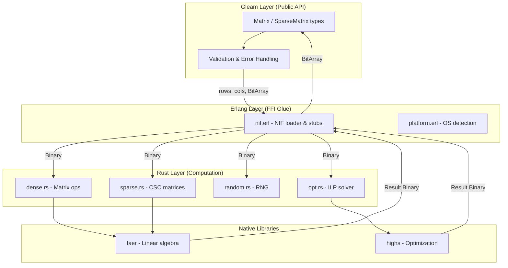
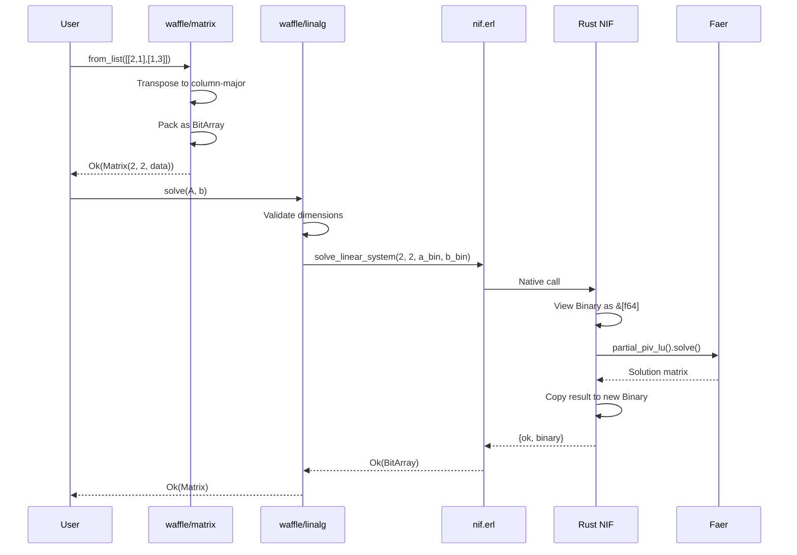
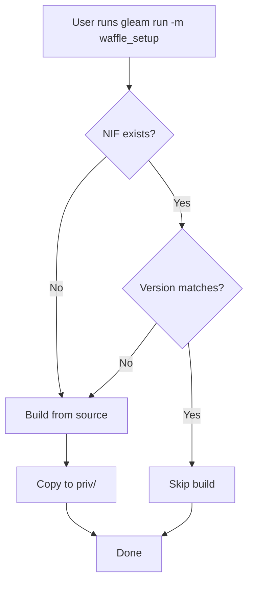

# Architecture

Waffle is a Gleam linear algebra library backed by Rust's `faer` crate via Rustler NIFs. It runs as a native extension inside the BEAM, not as a wrapper around external tools.

## Overview



## Layers

| Layer | Owns | Files |
|-------|------|-------|
| **Gleam** | Public types (`Matrix`, `SparseMatrix`, `Model`), validation, error handling, ergonomics | `src/waffle/*.gleam` |
| **Erlang** | NIF loading, function stubs that raise `nif_not_loaded`, OS detection for library extension | `src/waffle/internal/ffi/*.erl` |
| **Rust** | Computation, memory layout, zero-copy binary handling | `native/waffle/src/*.rs` |

### Gleam Layer

The public API. Owns all types that users interact with:

- `waffle/matrix` — Dense matrix operations
- `waffle/linalg` — Decompositions and solvers
- `waffle/sparse` — CSC sparse matrices
- `waffle/random` — Matrix generation
- `waffle/opt` — Linear and mixed-integer programming

Validates inputs before calling NIFs. Converts NIF results back to typed values.

### Erlang Layer

Minimal glue. Two files:

- `nif.erl` — Exports function stubs that raise `nif_not_loaded`. When the NIF loads, these are replaced with native implementations.
- `platform.erl` — Detects OS to choose `.so`, `.dylib`, or `.dll` extension.

### Rust Layer

Computation engine. Split by domain:

- `dense.rs` — Matrix arithmetic, decompositions (LU, QR, SVD), solvers
- `sparse.rs` — CSC format operations, sparse-dense multiplication
- `random.rs` — Uniform, normal, bernoulli distributions (ChaCha20)
- `opt.rs` — Linear and mixed-integer programming via HiGHS

All compute NIFs use `schedule = "DirtyCpu"` to avoid blocking the BEAM scheduler.

## Data Flow

Example: solving `Ax = b`



## Memory Layout

Matrices are stored **column-major** (Fortran order), matching faer's native layout.

```
User input (row-major):  [[1.0, 2.0],
                          [3.0, 4.0]]

Stored internally:       1.0, 3.0, 2.0, 4.0  (column-by-column)

Binary representation:   <<1.0:float-little-size(64),
                          3.0:float-little-size(64),
                          2.0:float-little-size(64),
                          4.0:float-little-size(64)>>
                          (32 bytes total)
```

This layout means:
- No transpose overhead when passing to faer
- `from_list` must transpose user input
- Iteration via `fold` proceeds column-by-column

## Build & Distribution

Waffle uses a source-build approach with smart caching. This solves a common Gleam hurdle: how to ship native code with a Hex package.

### Two Entry Points

| Script | Purpose | When to Use |
|--------|---------|-------------|
| `gleam run -m waffle_setup` | Build only if needed | End users after `gleam add waffle` |
| `gleam run -m waffle_build` | Always build from source | CI, development |

### How It Works



1. **Check for NIF** — Does `priv/waffle.{so,dylib,dll}` exist?
2. **Check version** — Compare NIF version against `gleam.toml`
3. **Build if needed** — Run `cargo build --release` in `native/waffle`
4. **Copy to priv/** — Move compiled library to `priv/`

### Version Synchronization

Three files must have matching versions:

| File | Field |
|------|-------|
| `gleam.toml` | `version = "0.3.0"` |
| `native/waffle/Cargo.toml` | `version = "0.3.0"` |
| `src/waffle/version.gleam` | `pub const package_version = "0.3.0"` |

Tests fail if `gleam.toml` and `version.gleam` drift. Setup rebuilds if NIF doesn't match `Cargo.toml`.

### Build Requirements

| Requirement | Notes |
|-------------|-------|
| Rust toolchain | Install via https://rustup.rs/ |
| cmake | Required by the `highs` crate (ILP solver) |
| libclang | Required by `highs-sys`, which generates its bindings with bindgen |

Install cmake: `apt install cmake` / `brew install cmake` / Windows: download from cmake.org
Install libclang: `apt install libclang-dev` / ships with Xcode command line tools on macOS

### Why Source Build?

- **Portability** — Compiles on any platform with Rust and cmake. No prebuilt binaries to maintain.
- **Minimal native deps** — Only cmake required. No BLAS/LAPACK to configure.
- **Hex-friendly** — Rust source ships with the package. Users need a Rust toolchain and cmake.

### Future: Prebuilt Binaries

Planned but not implemented: download prebuilt `.so`/`.dylib`/`.dll` from GitHub releases. Source build remains fallback.

## Key Design Decisions

| Decision | Rationale |
|----------|-----------|
| **Rustler + faer** | Pure Rust linear algebra. No BLAS/LAPACK linking issues. faer often outperforms OpenBLAS. |
| **HiGHS for optimization** | Mixed-integer linear programming solver. Requires cmake to build. |
| **DirtyCpu scheduler** | Matrix operations take >1ms. Must not block the main BEAM scheduler. |
| **Zero-copy input** | Viewing Erlang binaries as `&[f64]` avoids copying large matrices. |
| **Copied output** | Results are copied into new Erlang binaries. The NIF must own output memory. |
| **Column-major storage** | Matches faer's native layout. No runtime transpose. |
| **Opaque types** | Hides internal BitArray representation. Enables future layout changes. |

## Extending Waffle

Adding a new NIF function:

1. **Rust:** Add function in appropriate module (`dense.rs`, `sparse.rs`, etc.) with `#[rustler::nif(schedule = "DirtyCpu")]`
2. **Rust:** Register in `rustler::init!` in `lib.rs`
3. **Erlang:** Add stub in `src/waffle/internal/ffi/nif.erl`
4. **Gleam:** Add `@external(erlang, "nif", "function_name")` binding
5. **Test:** Write Gleam test via public API

See `AGENTS.md` for detailed instructions.
