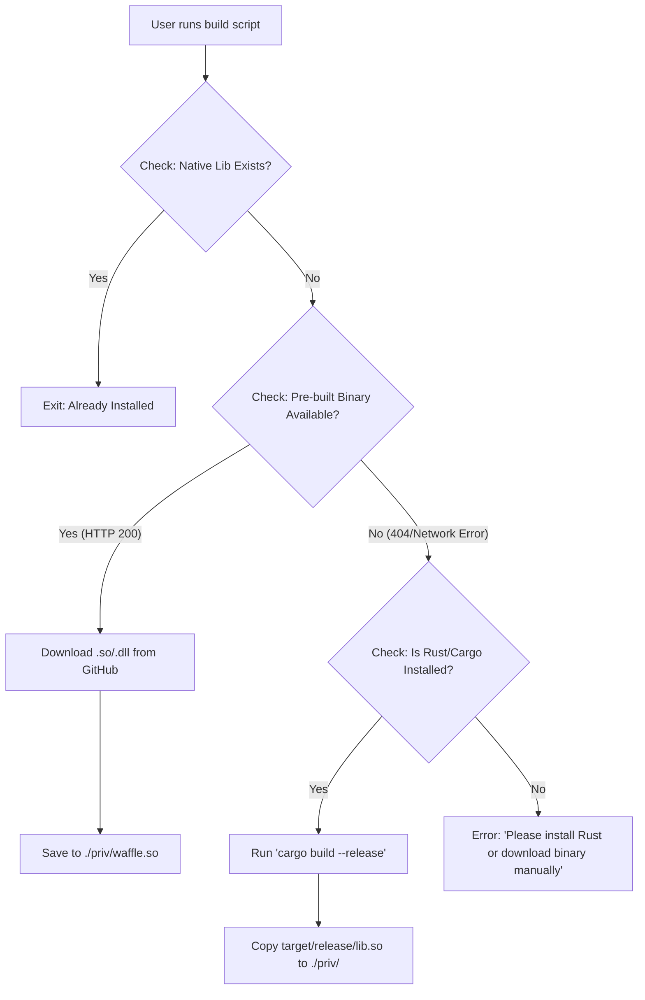

# Architectural Plan: `waffle`

## 1. Executive Summary
**Goal:** Create `waffle`, a library that brings state-of-the-art linear algebra performance to Gleam using the `faer` Rust crate.

**Why `faer`?**
* **Pure Rust:** No external C/Fortran dependencies (unlike LAPACK/BLAS), drastically simplifying the "Smart Build" process across different OSs.
* **Performance:** Often outperforms OpenBLAS on modern CPUs due to AVX512/SIMD optimizations.
* **Safety:** `faer` handles memory and parallelism safely.

**Key Features:**
* **Core:** `faer` LU decomposition (with partial pivoting) for solving linear systems.
* **Concurrency:** Uses **Dirty NIFs** (DirtyCpu scheduler) to prevent large matrix operations from blocking the Erlang VM.
* **Transport:** Zero-copy input (viewing Erlang Binaries as slices).
* **Build System:** A "Smart Build" script written in Gleam that downloads pre-compiled binaries, falling back to local compilation.

---

## 2. Architecture & Data Flow

### 2.1 The "Smart Build" Pipeline
*Triggered via:* `gleam run -m waffle/build`



### 2.2 Runtime Data Flow (`solve` operation)

1.  **Gleam:** Flattens `Matrix` to `BitArray` (Column-Major, F64).
2.  **BEAM (Erlang):** Passes the binary pointer to the NIF.
3.  **Rust (Rustler):**
    * Receives `Binary` pointer.
    * **Crucial Step:** The NIF is flagged as `DirtyCpu`. The BEAM moves this thread to a separate scheduler so `faer` can use 100% CPU without lagging the main application.
    * Creates `faer::MatRef` directly from the raw pointer (Zero-Copy).
    * `faer` computes $Ax = b$.
    * Result copied into a new `Binary` buffer.
4.  **Gleam:** Returns result.

---

## 3. Directory Structure

```text
waffle/
├── gleam.toml              # Dependencies: gleam_http, gleam_httpc (for downloader)
├── .github/
│   └── workflows/          # CI/CD for building releases
├── src/
│   ├── waffle.gleam       # Main library entry point
│   ├── waffle/
│   │   ├── matrix.gleam       # Matrix type definitions
│   │   ├── solver.gleam       # Linear solver logic
│   │   └── build.gleam        # THE SMART INSTALLER SCRIPT
│   └── waffle_ffi.erl     # Minimal Erlang glue (OS detection)
├── native/
│   ├── waffle/            # Rust crate
│   │   ├── Cargo.toml
│   │   └── src/lib.rs         # Rustler implementation
├── priv/                      # Where the compiled .so/.dll lives (gitignored)
└── README.md
```

---

## 4. Implementation Details

### 4.1 Rust Core (`native/waffle/src/lib.rs`)
Here we use `faer::MatRef` to view the data without owning it.

```rust
use rustler::{Binary, Env, Encoder, NifResult, Term, NewBinary};
use faer::{MatRef, Mat};
use faer::solvers::SpSolver; // Trait for solving
use std::slice;

// We mark this as DirtyCpu because solving a 1000x1000 matrix takes >1ms.
// Without this, the Erlang scheduler would hiccup.
#[rustler::nif(schedule = "DirtyCpu")]
fn solve_linear_system<'a>(
    env: Env<'a>, 
    rows: usize, 
    cols: usize, 
    bin_matrix: Binary<'a>, 
    bin_rhs: Binary<'a>
) -> NifResult<Term<'a>> {
    
    // 1. Safety Checks (Length validation)
    let matrix_len = rows * cols * 8; // 8 bytes per f64
    if bin_matrix.len() != matrix_len {
        return Ok((crate::atoms::error(), "invalid_matrix_size").encode(env));
    }

    // 2. Zero-Copy Views (Unsafe Cast)
    // We assume the host is Little Endian (standard for x86/ARM).
    let matrix_slice: &[f64] = unsafe {
        slice::from_raw_parts(bin_matrix.as_slice().as_ptr() as *const f64, bin_matrix.len() / 8)
    };
    let rhs_slice: &[f64] = unsafe {
        slice::from_raw_parts(bin_rhs.as_slice().as_ptr() as *const f64, bin_rhs.len() / 8)
    };

    // 3. Create Faer Matrices (Column Major is standard)
    let mat_a = MatRef::from_column_major_slice(matrix_slice, rows, cols);
    let mat_b = MatRef::from_column_major_slice(rhs_slice, rows, 1); // Assuming vector B

    // 4. Solve Ax = b using LU Decomposition with Partial Pivoting
    let lu = mat_a.partial_piv_lu();
    let x = lu.solve(mat_b);

    // 5. Return Result
    // We need to copy the result 'x' back into an Erlang Binary
    let result_len = x.nrows() * x.ncols() * 8;
    let mut binary = NewBinary::new(env, result_len);
    
    unsafe {
        let dest_ptr = binary.as_mut_slice().as_mut_ptr() as *mut f64;
        // faer stores column-major by default
        std::ptr::copy_nonoverlapping(x.as_ptr(), dest_ptr, x.nrows() * x.ncols());
    }

    Ok((crate::atoms::ok(), binary.into()).encode(env))
}

mod atoms {
    rustler::atoms! { ok, error }
}

rustler::init!("waffle_ffi", [solve_linear_system]);
```

### 4.2 The Gleam "Smart Build" Script (`src/waffle/build.gleam`)
This script serves as the "installer" for the library.

```gleam
import gleam/io
import gleam/httpc
import shellout // Wrapper for shell commands (needs implementation/dependency)

const version = "0.1.0"
const repo = "yourname/waffle"

pub fn main() {
  io.println("🚀 Starting waffle setup...")

  case download_precompiled() {
    Ok(_) -> io.println("✅ Pre-compiled binary installed!")
    Error(_) -> {
      io.println("⚠️ Download failed/unavailable. Attempting local compilation...")
      compile_local()
    }
  }
}

fn download_precompiled() -> Result(Nil, Nil) {
  // 1. Detect OS/Arch (requires simple Erlang FFI helper)
  let target = detect_target() 
  let url = "[https://github.com/](https://github.com/)" <> repo <> "/releases/download/v" <> version <> "/waffle-" <> target <> ".so"
  
  // 2. Fetch using httpc
  // 3. Write bytes to ./priv/waffle_ffi.so
  // ... (implementation details depend on httpc usage)
}

fn compile_local() {
  // Run cargo build --release
  // Copy artifact to priv/
}
```

### 4.3 The Load Check (`src/waffle.gleam`)
Ensures the user knows *why* it failed if they didn't run the build script.

```gleam
@external(erlang, "waffle_ffi", "solve_linear_system")
fn solve_nif(rows: Int, cols: Int, mat: BitArray, vec: BitArray) -> Result(BitArray, String) {
  // Replaced by NIF at runtime.
  exit("NIF not loaded! Please run `gleam run -m waffle/build` first.")
}
```

---

## 5. Build Strategy & Distribution

### 5.1 The Pre-Compilation Advantage
Since `faer` is pure Rust, we can cross-compile strictly easier than `nalgebra` (which often wants system LAPACK).

**`waffle/build.gleam`** logic:
1.  **Check OS:** Linux/Mac/Windows.
2.  **Download:** Fetch `waffle-{os}-{arch}.so` from GitHub.
3.  **Fallback:** `cargo build --release`.

### 5.2 GitHub Actions (CI)
Since we don't need to install `gfortran` or `libopenblas-dev`, the CI is very fast.

```yaml
jobs:
  build-release:
    runs-on: ${{ matrix.os }}
    strategy:
      matrix:
        os: [ubuntu-latest, macos-latest, windows-latest]
    steps:
      - uses: actions/checkout@v3
      - uses: dtolnay/rust-toolchain@stable
      - run: cargo build --release --manifest-path native/waffle/Cargo.toml
      # ... rename and upload logic ...
```

---

## 6. Critical Risks & Mitigations

| Risk | Impact | Mitigation |
| :--- | :--- | :--- |
| **Blocking the BEAM** | Critical | Use `#[rustler::nif(schedule = "DirtyCpu")]`. Linear algebra is computationally heavy; running on the main scheduler will freeze the application. |
| **Panic in Rust** | Medium | `faer` might panic on Singular Matrices if not handled carefully. **Mitigation:** Wrap the solve call in `std::panic::catch_unwind` if you want 100% crash safety (though `rustler` generally isolates process crashes). |
| **Memory Usage** | Medium | `faer` allocates workspace memory. For massive matrices, this could OOM the container. **Mitigation:** Document memory requirements for large $N$. |
